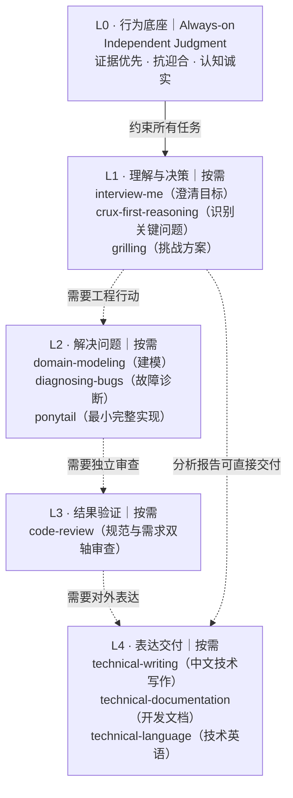

# Skills

**原则：独立判断贯穿始终；明确问题 → 解决问题 → 验证结果 → 清晰交付。**

**这是一张能力关系图，不是强制流水线。** 只有 L0 常驻；其余根据任务选择，简单任务可跳过中间层。

当前 **10 个精选候选 Skill**（Matt 4/31），尚未完成实际效果验收或本机剪枝。上游 submodule 只是来源库，不代表全量启用。

[选用清单](registry/skills.yaml) · [候选与排除清单](registry/curation.yaml) · [剪枝标准](registry/pruning.md)
