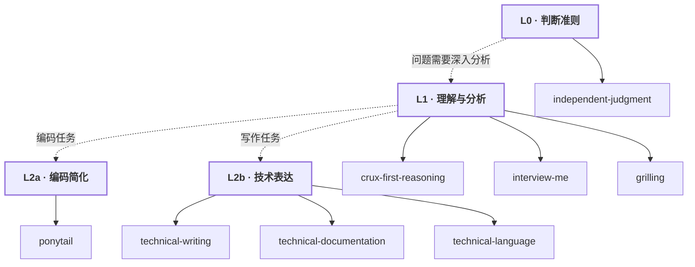

# Skills

**判断可靠 → 深入分析 → 按需交付。** 所有核心能力均以 Skill 管理。

**核心 2 个**：`independent-judgment`（判断纪律）、`crux-first-reasoning`（深度分析）。其他 6 个按任务调用，不强制逐层执行。

**精选 8 个 Skill**，其中 Matt 仅 `grilling`（1/31）。Skill 的存储形式不保证每次自动调用；本机 80 个目录尚未调整。

[选用清单](registry/skills.yaml) · [剪枝分组](registry/curation.yaml) · [调用边界](core/README.md)
