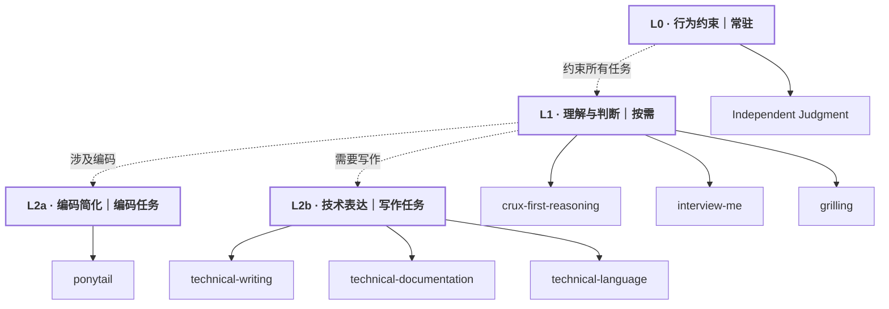

# Skills

**全局约束 → 理解与判断 → 按任务交付。**

**真正的核心**：Independent Judgment（常驻规则）+ Crux-First Reasoning（复杂判断时触发）。其余 6 个 Skill 按需选用；流程不必逐层经过。

**精选 7 个 Skill，Matt 只保留 grilling（1/31）。** `domain-modeling`、`diagnosing-bugs`、`code-review` 已退出精选，不影响通常的建模、调试和审查工作。

[精选清单](registry/skills.yaml) · [剪枝分类](registry/curation.yaml) · [核心原则](core/README.md)

> 本机 80 个 Skill 尚未停用；上游 submodule 仍保留。
