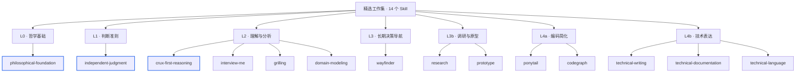

# Skills

**目标：用少量、边界明确的 Skill，让 Agent 更可靠地判断问题、选择方法并交付结果。**

**版本变更与 Claude handoff**：阅读 [CHANGELOG.md](CHANGELOG.md)。它记录为何从薄弱假设优先转向主要矛盾优先、三个核心 Skill 的分工、常驻 Hook 的边界及版本验收情况，并随 Plugin 一起分发。

这是一个面向 Codex、Claude Code、Pi 等编码 Agent 的 Skill 精选与管理仓库。我们关心的不是收集了多少技能，而是：当用户的判断或要求可能有误时，Agent 能否指出问题；当任务复杂时，能否抓住关键；当任务明确时，能否直接完成，而不是套用一整套无关流程。

## 为什么要这样组织

本机盘点曾发现 **80 个 Skill 目录**。它们来自不同上游，既有通用方法，也有工程专项和项目私有流程。如果不加筛选地全部作为默认工作集，就可能带来触发边界重叠、重复访谈、过度分析以及维护成本增加。更多 Skill 不等于更好的工作结果。

当前采用 **一个顶层哲学 Skill + 两个判断核心** 的结构：

- **Philosophical Foundation（哲学基础）**：从联系、矛盾与变化中理解问题，兼顾二阶效应、简化、反馈、可逆性与知止。这是项目内的 L0 方法论层，不是系统指令优先级，也不强迫每个任务输出哲学分析。

- **Independent Judgment（独立判断）**：用户可能误判事实，也可能把一种实现方式误当成唯一正确的方案。Agent 应基于证据判断，必要时建设性指出要求中的重大问题，而不是机械迎合；同时不为反对而反对，尊重用户充分知情后的合理选择。
- **Crux-First Reasoning（关键问题推理）**：复杂问题不缺现象和因素清单，缺的是识别当前**起主导作用的矛盾及制约关系**。Agent 应先明确真实目标与现实差距，辨明主要矛盾及主次关系；再识别可能改变判断的关键不确定性，并通过呈现关键证据与逻辑关系，引导用户理解问题本质、形成可行动的判断。

哲学基础提供观察与行动的总视角；独立判断约束**判断是否可靠**，关键问题推理负责**识别主要矛盾、辨析主次并解释关键判断依据**。其余能力按任务选取，不强制每次都经过澄清、分析、开发、审查、写作的完整流程。

## 怎么组织：能力分层，Skill 各自独立



*蓝色边框为 L0 哲学基础与两个判断核心。层级是能力分类，不是强制调用顺序，也不是自动调度器；每个 Skill 仍单独按需加载。*

### 哲学基础与两个判断核心如何配合

[`philosophical-foundation`](skills/philosophical-foundation/SKILL.md) 保留原有 AGENTS.md 中的哲学、方法论与工程原则（不包含个人输出风格）；其他 Skill 可按需使用其观点，但不会被它强制编排。

[**independent-judgment**](skills/independent-judgment/SKILL.md) 适用于有实质判断的任务，包括用户明确要求执行、但所指定的方法可能违背其目标的情况。它负责识别事实错误、证据缺口、推理跳跃和价值分歧，并在必要时提出更合适的替代方案；它不要求每次都反驳用户。

[**crux-first-reasoning**](skills/crux-first-reasoning/SKILL.md) 用于需要判断主次并解释依据的复杂问题，包括根因诊断、战略判断、架构取舍，以及需要提炼关键问题的检查、调研和状态汇报。它先识别当前主要矛盾和制约关系、解释为什么它比其他因素更重要，再针对可能改变判断或行动的关键不确定性选择验证方法，并帮助读者理解判断如何成立。简单事实、纯清单、翻译、文字润色与直接执行不需要启动它。

例如，用户说“接口变慢了，把数据库全部换掉”。前者提醒 Agent：**用户提出的解决办法尚未被证实**；后者围绕性能目标与当前调用链表现的差距，判断真正制约响应速度的环节。如果证据不足，再选择能区分数据库、业务服务等解释的检查，并说明为什么它最有判断价值。两者可配合，也可以独立使用。

### 十一个专项 Skill 为什么保留

| Skill | 解决的问题 | 何时调用 |
| --- | --- | --- |
| `interview-me` | 关键需求不明确，贸然执行容易理解错目标 | 缺失信息确实影响下一步时 |
| `grilling` | 需要系统性挑战已有观点或方案 | 用户明确要求压力测试时 |
| `wayfinder` | 多会话目标路径未知，静态任务清单无法承载逐步涌现的决策 | 建立或推进决策地图、前沿与迷雾时 |
| `domain-modeling` | 统一领域术语、模型边界和 ADR 决策依据 | 主动设计领域模型或由 Wayfinder 调用时 |
| `research` | 基于一手资料调研并将证据写入项目 | 需要独立事实调研或由 Wayfinder 调用时 |
| `prototype` | 用低成本、可丢弃的逻辑或 UI 原型验证设计选项 | 决策需要可交互原型或由 Wayfinder 调用时 |
| `ponytail` | 工程实现容易引入不必要的复杂性 | 编码时追求最小但完整的实现 |
| [`codegraph`](skills/codegraph/SKILL.md) | 从已有代码中追踪跨文件调用、影响范围和受影响测试 | 本地 CodeGraph 索引和 CLI/MCP 可用时，开展复杂代码结构分析；环境不具备时降级 |
| `technical-writing` | 中文技术文稿有结论却缺少背景、证据和设计依据 | 写技术方案、架构说明、评审材料时 |
| `technical-documentation` | 开发文档难以帮助读者理解或完成任务 | README、API 文档、教程等开发者文档 |
| `technical-language` | 英文技术表达不准确、不自然或不一致 | 技术英语编辑与改写时 |

这十一项提供专项方法，不改变通用判断准则。例如写一篇已有明确事实依据的 README，可以直接使用文档写作能力，不必先启动访谈或复杂推理。

## 怎么筛选，而不是继续堆积

一个 Skill 进入精选清单，应当满足三个条件：有**独特且重复出现**的用途，触发边界明确，以及相较于不加载该 Skill 有可以检验的价值。我们不按上游仓库整体引入，也不因为一个流程看起来专业就默认启用。

`diagnosing-bugs`、`code-review` 等专项 Skill 仍在候选清单中。来自 Matt 的 `grilling`、`wayfinder`、`domain-modeling`、`research`、`prototype` 均从固定版本的 Submodule 构建，不复制或修改正文。Wayfinder 原版要求 Issue Tracker、部分场景要求 Subagent；在 Web 环境缺少相应能力时，实际执行应按可用工具验证，不宣称兼容已通过。

## 预期获得什么，以及目前做到哪里

这套组织方式希望产生三个效果：减少不必要的 Skill 触发和流程负担；让用户提出错误前提时，Agent 能保持独立判断；让复杂分析优先关注真正影响选择的因素，同时保持交付物对读者友好。

**这些是设计目标，不是已经验证的性能结论。** 目前精选 **14 个候选 Skill**：其中 10 个选自原有本机 80 项（通过固定版本上游来源管理），另有 3 个自研判断核心和 1 个维护中的开源工具适配 Skill（CodeGraph）。原有 **80 个本机目录尚未停用或删除**；Skill 的版本管理也不意味着它已在各客户端自动安装或每次被调用。后续应通过同任务的 A/B 行为测试，检验触发准确性、结果质量及额外开销。

## 仓库中的文件分别做什么

| 位置 | 作用 |
| --- | --- |
| [`skills/`](skills/) | 维护三个自研判断 Skill 和一个 CodeGraph 工具适配 Skill 的正文、参考资料与测试 |
| [`upstream/`](upstream/) | 通过 Git submodule 固定第三方来源；**来源库不等于全量启用** |
| [`registry/skills.yaml`](registry/skills.yaml) | 当前 14 个精选候选 Skill 及其来源路径 |
| [`registry/curation.yaml`](registry/curation.yaml) | 全部盘点对象的精选、未选中、项目专用等状态 |
| [`profiles/core.yaml`](profiles/core.yaml) | 目标角色与触发条件；**不是客户端自动生效的配置** |
| [`CHANGELOG.md`](CHANGELOG.md) | 版本化设计决策与 Claude handoff；唯一维护源，自动打包进 Plugin |
| [`registry/pruning.md`](registry/pruning.md) | 取舍依据、未选中项和可逆剪枝原则 |
| [`tests/`](tests/) | 待执行的行为验收与 A/B 测试案例 |

本仓库先回答 **“为什么选择这些 Skill，以及它们应该在什么任务上发挥作用”**。实际安装、启用与本机剪枝是下一步独立的工作，不应与精选结论混为一谈。

## 一次安装 14 个 Skill：ChatGPT Plugin

**本地 Agent 核心常驻（可选 Hook）**：[`core/always-on.md`](core/always-on.md) 维护独立判断、主要矛盾优先、关键不确定性从属和关键论证等轻量原则，并附三个核心 Skill 的本地及 GitHub 链接。发布工具将其与 [`core/hooks.json`](core/hooks.json) 一起打包；在支持 SessionStart Hook 的 Codex/Claude Code 本地运行时，安装 Plugin 并按需信任 Hook 后，于启动、恢复、清除、压缩或分叉时注入。缺失规则文件时静默跳过，不阻断会话。**Web Plugin 仍为按需加载，不应宣称全局常驻。**


ChatGPT 的单个 Skill 上传入口不能直接识别包含多个 Skill 的仓库；为保留独立触发并免去 14 次手工上传，本仓库提供 [oydodo Skills Plugin](plugins/oydodo-skills/README.md)：一个 Plugin 内打包 **14 个独立的 Skill**，通过 [GitHub Marketplace](.agents/plugins/marketplace.json) 分发，不合并成“万能 Skill”。

**CodeGraph 单独安装**：Skill 只教 Agent 在可用时使用 [CodeGraph CLI/MCP](https://github.com/colbymchenry/codegraph)，不会自动安装程序、连接 MCP 或创建本地索引；Web 对话不能据此访问本地仓库。

在支持 Plugin Marketplace 的 ChatGPT 桌面版 / Codex 环境运行：

```bash
codex plugin marketplace add oydodo/skills
codex plugin add oydodo-skills@oydodo
```

首次添加来源后仅需安装一个 Plugin。**2026-10-29 已在 Mac 上验证旧版 8 Skill 插件的 CLI 安装**；桌面新会话的自动触发仍待实测，详见[安装验收记录](tests/chatgpt-plugin-install-2026-10-29.md)。重启 ChatGPT 桌面版并在新会话验证。**Mac 本地 CLI 安装已验证**；如果需要 ChatGPT Web/iOS，可由工作区管理员通过 [Admin → Plugins → Import marketplace](https://learn.chatgpt.com/docs/enterprise/plugin-management) 导入同一 GitHub 仓库，并对相关角色设置 Installed。ChatGPT Web 端曾有导入记录，但最新版本是否同步仍需以后台同步记录为准。第三方固定版本、有限触发描述适配和许可见 [来源与改动](plugins/oydodo-skills/SOURCES.md)。

## 统一自动构建与发布（ChatGPT + Claude）

**唯一维护入口**：自研 Skill 修改 `skills/`；第三方升级调整 `upstream/` 的 Git submodule 固定提交；精选清单与触发描述修改 `registry/skills.yaml`。**不要直接编辑生成目录** `plugins/oydodo-skills/skills/`。

推送到 `main` 后，[发布流水线](.github/workflows/publish-plugins.yml)自动重新生成统一 Skill 树、保存第三方许可证、校验两个 Plugin、递增版本并提交到 GitHub Marketplace 目录，同时发布 [ChatGPT / Claude 双 ZIP](https://github.com/oydodo/skills/releases/latest)。

- **ChatGPT Web**：已导入的 GitHub Marketplace 可同步 `main` 的新版本，受平台同步和审批策略影响。
- **Claude Web 个人账户**：优先在 Customize → Plugins → Add → Add marketplace → Add from a repository 中导入 `oydodo/skills`，统一使用 GitHub Marketplace；如入口不可用再上传 Claude ZIP。GitHub 仓库同步受平台策略影响，个人账户是否每次推送后自动刷新尚待实测。
- **Claude 团队工作区**：若需 GitHub 自动同步，应另配符合要求的私有 Marketplace 镜像；当前未配置。

操作说明见 [分发与发布指南](docs/distribution.md)。
