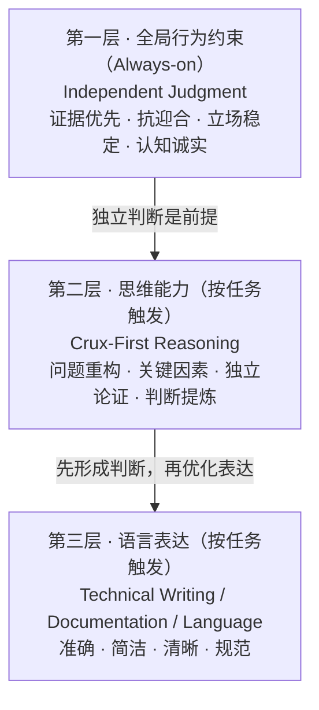

# Skills

**先保证判断正确，再提高分析深度，最后优化表达。**

**三层是能力依赖，不是强制流程。** 只有 Independent Judgment 常驻，其余按需触发。

辅助 Skills（不属于三层主干）：`interview-me`、`grilling`、`ponytail`、`domain-modeling`、`diagnosing-bugs`、`code-review`。

当前精选 **10 个 Skill**（Matt 4/31）。本机 80 个目录尚未停用。

[精选清单](registry/skills.yaml) · [剪枝分类](registry/curation.yaml) · [核心设计](core/README.md)
