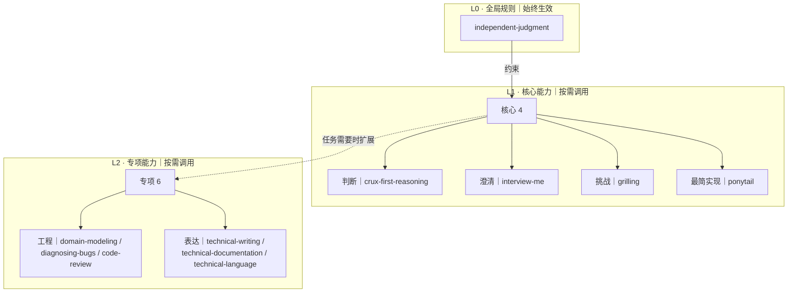

# Skills

自研核心 + 精选上游。**目标工作集：10 个 Skill（Matt 仅 4/31）**。

**层次表示约束与能力扩展，不是强制执行顺序。** 只有全局规则常驻，其他 Skill 按需触发。

[精选清单](registry/skills.yaml) · [完整剪枝分组](registry/curation.yaml) · [剪枝依据](registry/pruning.md)

> 本机仍安装原有 80 个目录。此处是目标选用清单，**尚未实际停用本机 Skill**。
